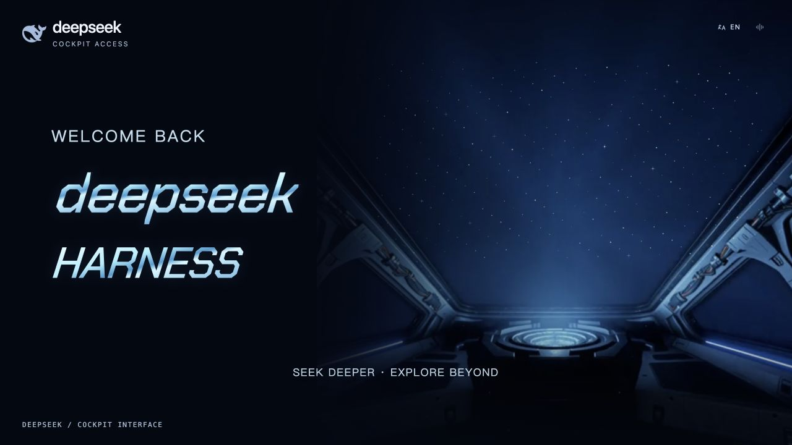

# DeepSeek Cockpit Startup

DeepSeek Harness 的机甲驾驶舱启动插件。默认英文，支持中文切换，声音默认开启。



**访问许可确认 → 默认身份确认 → 渐进加载 → 确认进入 → DeepSeek Harness 欢迎主画面 → Harness 工作区。**

完整点阵鲸鱼渐显并闪白，驾驶舱逐层点亮；欢迎画面使用逐字加速艺术字、循环背景视频和鲸鱼消散为星星的 Canvas 动画。没有重播入口、普通登录输入框、音色选择或背景替换浮层。

## 安装

1. 在 [Releases](https://github.com/wangyiyi2056/dsh-cockpit-startup/releases/latest) 下载 `dsh-cockpit-startup-1.0.0.tgz`。
2. 完全退出 DeepSeek Harness 桌面端。
3. 在安装包所在目录执行：

```bash
dsh plugin --profile desktop add ./dsh-cockpit-startup-1.0.0.tgz
dsh plugin --profile desktop list
```

重新打开 Harness 即可。Web profile 使用：

```bash
dsh plugin --profile web add ./dsh-cockpit-startup-1.0.0.tgz
```

如果已安装社区 `dsh-startup-screen`，先在对应 profile 的插件管理中停用它，避免两个启动画面同时覆盖。

卸载：

```bash
dsh plugin --profile desktop remove dsh-cockpit-startup
```

## 使用与配置

前两步各点击一次确认，默认身份自动核验，不需要输入密码。最后点击 `ENTER DEEPSEEK`，展示完整欢迎动画，默认停留 12 秒后淡出到工作区。欢迎画面可按 Enter 提前进入工作区；任意阶段按 Esc 可直接放行。

设置 → **DeepSeek Cockpit**：

| 配置 | 默认值 |
| --- | --- |
| 启用 | 开启 |
| 播放时机 | 每个浏览器会话一次，可改为每次打开 / 每天一次 |
| 界面语言 | English |
| 身份名称 | EXPLORER 01 / 探索者 01，支持自定义 |
| 语音与音效 | 开启 |
| 加载时长 | 11 秒，范围 8–16 秒 |
| 欢迎画面停留 | 12 秒，范围 10–30 秒 |
| 自定义图片 / 视频 | 留空使用内置素材 |

配置保存在 `$DSH_HOME/dsh-cockpit.json`，默认 `~/.dsh/dsh-cockpit.json`。无 HTTP Host 的客户端回退模式使用浏览器本地配置。启动画面右上角仅保留语言和声音切换，这两个偏好在当前浏览器保存；设置页保存时更新偏好。

后续替换背景：在设置页填写 HTTPS 视频或图片地址，也可以使用宿主已提供的同源 `/路径`。只填写图片时显示静态背景；填写视频时优先播放该视频。点阵、艺术字和星空动画独立绘制，替换素材不需要重做动画。也可以替换仓库 `assets/` 中同名文件，再重新打包。

语音沿用社区版自然英语女声优先策略，语速 `0.88`、音调 `0.85`、开口留白 `240ms`。六句短播报覆盖许可、身份、唤醒、授权和欢迎；加载阶段补充合成机械提示音。浏览器第一次点击或按键后解锁声音，无额外启用提示。具体声线由系统提供的 Web Speech 音色决定。

## 从源码构建与预览

Node.js **20+**，无第三方 npm 依赖。

```bash
git clone https://github.com/wangyiyi2056/dsh-cockpit-startup.git
cd dsh-cockpit-startup
npm test
npm run pack:release
npm run preview
```

预览地址 `http://127.0.0.1:4173/`；`/client-preview` 演示客户端 ModuleLoader 回退挂载，`/mobile-preview` 预览 375px 窄屏，`/frame` 单独预览视觉。预览页面中的工作区是占位内容。

安装包输出到 `releases/`。`npm pack` 自动构建，图片、8 秒静音视频和艺术字体都嵌入包中，默认视觉不依赖 CDN。系统在线语音是否联网由浏览器与操作系统决定。

`docs/ci-example.yml` 提供 Node 20 / 22 / 24 的 GitHub Actions 检查示例。当前上传凭据没有 `workflow` 权限，因此仓库未启用自动工作流；需要时可在 GitHub 网页端将它放到 `.github/workflows/test.yml`。

```text
src/host.js       Host：tapIndex、路由、配置持久化、连接信任检查
src/client.js     ModuleLoader 客户端：设置页、回退挂载
src/runtime.js    启动覆盖层、播放频率、焦点与卸载管理
src/scene/        已定稿画面、点阵鲸鱼、星空、英文短播报
assets/          背景、视频、标识与离线艺术字体
scripts/         构建、预览、打包
test/            Host / 客户端 / 生命周期 / 语音测试
```

## 兼容与验证范围

Host 导出 `name / inject / apply`，通过 `cordis.patch.yml` 安装；客户端使用 `window.__ModuleLoader__.load` 与 `settings.section`，参考 [社区插件](https://github.com/QIFANAI/dsh-startup-screen)。未复制其整套视觉代码。

已验证 Node 自动测试、真实 HTTP 路由、浏览器完整流程、欢迎画面自动释放、会话去重和独立客户端挂载。开发环境未安装 DeepSeek Harness，**尚未完成真实 Harness Desktop 的安装实测**。采用社区现有插件接口；不同宿主版本的兼容性仍需实际安装确认。

权限与密码画面是启动仪式，不执行真实身份认证，也不修改 Harness 的权限、登录状态或安全设置。脚本启动失败时自动移除覆盖层；插件卸载会恢复工作区的焦点、滚动及可交互状态。

## 致谢与许可

代码 MIT。社区语音选择策略与接入方式参考沈宏宏及社区贡献者的 `dsh-startup-screen`，保留原版权声明。驾驶舱图片与背景视频为本项目生成素材；Chakra Petch 字体遵循 SIL OFL。未打包电影原声或商业音乐。详见 [第三方说明](THIRD-PARTY-NOTICES.md)。

这是独立社区插件，与 DeepSeek 官方无隶属关系；DeepSeek 标识与商标归原权利方所有。
